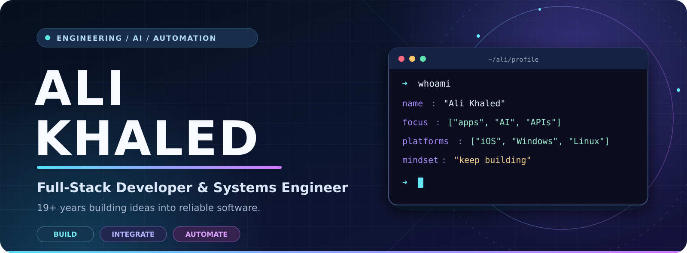
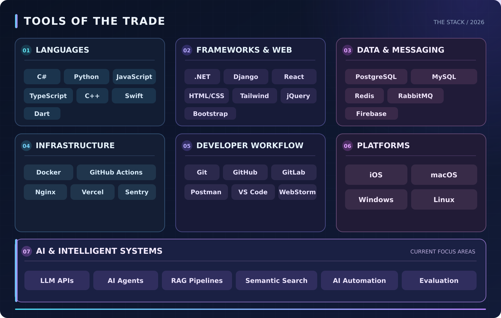

  

   

  <a href="https://github.com/ali-khaled-949"><b>GitHub</b></a>
  &nbsp; • &nbsp;
  <a href="mailto:solidinnovator@gmail.com"><b>Let's connect</b></a>

    

  <b>FULL-STACK DEVELOPMENT</b> &nbsp; / &nbsp; <b>AI ENGINEERING</b> &nbsp; / &nbsp; <b>AUTOMATION</b>

---

### 👋 Hey, I'm Ali.

I'm a full-stack developer with **19+ years of experience** working across software, systems, languages, and platforms. I enjoy taking complex ideas, untangling the moving parts, and turning them into software that feels simple to use and solid under the hood.

From user-facing applications to the APIs, databases, and infrastructure behind them, I like building the **whole solution**. I'm also focused on the next wave of software: **practical AI integration and intelligent automation**.

### ⚡ What I bring to the table

|  | Focus | How I approach it |
| :--: | :-- | :-- |
| 🧩 | **Build** | Thoughtful web, desktop, and mobile experiences, backed by dependable services. |
| 🔗 | **Integrate** | Connect applications, data, and third-party systems through clean, secure APIs. |
| ⚙️ | **Automate** | Turn repetitive workflows into reliable tools and processes that save time. |
| 🛠️ | **Engineer** | Work across the application, database, and infrastructure layers to solve problems end to end. |
| 🤖 | **Explore AI** | Build toward useful AI-assisted experiences, agents, and knowledge-aware tools. |

### 🤖 AI engineering & what's next

My current areas of exploration and development include:

- **LLM integrations** — connecting applications to modern language-model APIs.
- **AI agents and tool use** — designing workflows that can reason through steps and use services responsibly.
- **RAG and semantic search** — connecting AI experiences to relevant documents and data.
- **Intelligent automation** — bringing AI into real workflows with human oversight.
- **Evaluation and safeguards** — keeping AI features useful, reliable, and secure.

### 🧰 The toolbox

  

  
<b>View the tech stack as text</b>

   

  - **Languages:** C#, Python, JavaScript, TypeScript, C++, Swift, Dart
  - **Web and frameworks:** ASP.NET Core, Django, React, HTML, CSS, Tailwind CSS, Bootstrap, jQuery
  - **Databases and messaging:** PostgreSQL, MySQL, Redis, RabbitMQ, Firebase
  - **Infrastructure and delivery:** Docker, Nginx, Vercel, GitHub Actions, Sentry
  - **Developer workflow:** Git, GitHub, GitLab, Postman, VS Code, WebStorm
  - **Platforms:** iOS, macOS, Windows, Linux
  - **AI focus areas:** LLM APIs, AI agents, RAG, semantic search, intelligent automation, evaluation

### 🌐 Cross-platform by design

I work across **iOS, Windows, and Linux** environments, with an emphasis on integrating the pieces that make an application useful in the real world: the interface, the services, the data, and the deployment.

### 💬 Let's build something worth using

Have a project, collaboration, or technical challenge in mind? I'd love to hear about it.

  <a href="mailto:solidinnovator@gmail.com"><b>✉️ Email me</b></a>
  &nbsp; &nbsp; • &nbsp; &nbsp;
  <a href="https://github.com/ali-khaled-949"><b>⌘ Explore my GitHub</b></a>

Build with purpose. Engineer for reliability. Keep learning.

<!--
  All README images are in ./assets. Upload README.md and the assets folder
  to the root of your GitHub profile repository (ali-khaled-949/ali-khaled-949).
  This profile deliberately avoids remote image services so the graphics stay stable.
-->
